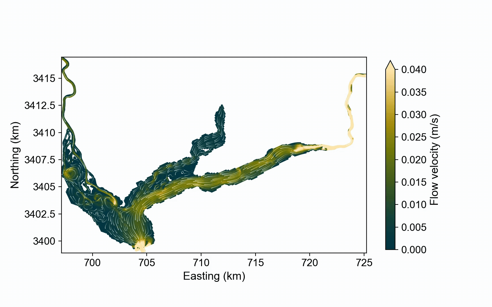

# Delft3D-FM model of Lake Seminole (USA)
This repository contains the outputs of my postdoc project at Boston College on reservoir sedimentation in Lake Seminole. This repository includes the Delft3D-FM input files, python scripts, plots, and animations.

In particular, you can find:
- **input_files**: folder with the necessary files to run the Delft3D-FM model.
- **particle_tracking**: folder with the Python script that couple the Delft3D-FM model with the Lagrangian particle routing model _dorado_.
- **post_processing**: folder with Python script to generate animations.
- **publications_conferences**: folder with the references and files of peer-reviewed (or pre-print) publications, conferences presentation and posters that feature the model.
- **streamlines**: folder with a Python script to generate streamlines from Delft3D-FM output.

As of today (14 October, 2026), the project is still on going. As long as I am part of the project, I will constantly upload new material and scripts, as I constantly try to improve the model and use it to understand how sedimentation in Lake Seminole evolves and what are the effect of water management.
